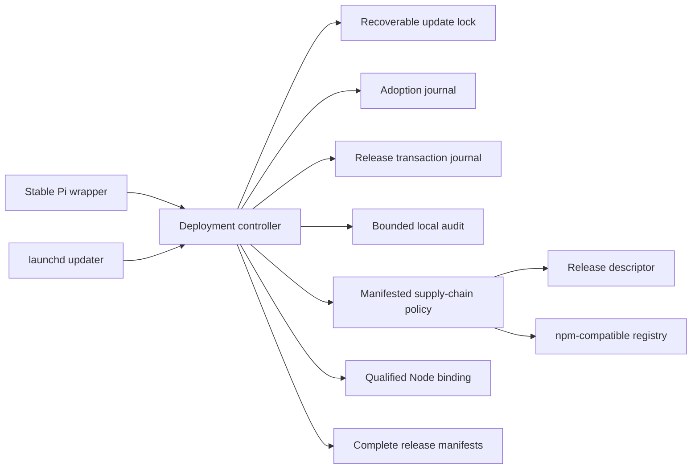

# Transactional Harness Hardening Design

- Status: approved in chat (`Go A et ALL`)
- Date: 2026-09-09
- Scope: local Pi/Gondolin deployment controller

## Context

The qualified Node binding removes the original Homebrew keg pin failure, and
the nominal suite passes 130 tests. A post-merge review nevertheless found that
the implementation does not yet satisfy its strongest guarantees:

- the repository CI guard rejects the two new runtime test files;
- a process killed while holding `update.lock` leaves recovery permanently
  inaccessible;
- the adoption journal can expose an empty `adoption/` directory before the
  first durable journal exists;
- release links and `deployment.json` change in separate operations without a
  recovery journal;
- the active release manifest covers only selected entry points, not the code
  those entry points import;
- status probes inherit the caller environment;
- absolute deployment paths persist the local account name in state;
- release and automation mutations have no bounded local audit trail;
- the latest-release HTTP body is unbounded;
- the default update control plane is not sovereign and this exception is not
  represented as machine-readable policy; and
- the Gondolin dependency graph currently resolves `undici@6.27.0`, which is
  covered by moderate-severity advisories fixed in `6.28.0`.

These are correctness and security gaps, not optional convenience work.

## Decision axes

The design applies the project order without exception:

1. Security: fail closed on ambiguous ownership, state, provenance, or
   recovery; never expose caller secrets to administrative probes.
2. Quality: every durable phase has deterministic recovery and a test that
   observes the pre-fix failure before implementation.
3. Performance: full release verification remains on the launch path because
   security wins, but its cost is measured and reported.
4. Completeness: CI, documentation, migration, audit evidence, dependency
   health, and deployed smoke tests are part of the same change.

## Invariants

1. A live update process owns at most one private update lock.
2. A dead lock owner cannot permanently block the next invocation.
3. Unparseable, public, foreign-owned, or symlinked lock state is never
   reclaimed automatically.
4. Every visible transaction directory contains a complete, fsynced journal.
5. A release transaction is either restored to its exact before-state or
   completed to its exact after-state.
6. `current`, `previous`, and `deployment.json` are never trusted separately;
   the transaction journal is the reconciliation authority while present.
7. A release is executable only when every regular file in its immutable tree
   matches the release manifest and no symlink or special file is present.
8. Administrative qualification and status children receive only an explicit
   environment allowlist.
9. Persisted controller and audit JSON contains no username, home directory,
   project path, prompt, command, provider credential, or raw environment
   value.
10. Audit records contain stable action identifiers and outcomes, but no local
    identity. The deployment remains explicitly single-user.
11. Update endpoints are loaded from a controller-manifested policy, never
    from caller environment or npm configuration.
12. Unknown versions, phases, fields, URL schemes, files, and transitions fail
    closed.

## Component boundaries



The controller is the only mutation coordinator. Journals do not call each
other, and read-only status never performs recovery or cleanup.

### Update lock

`release-manager.mjs` keeps the existing directory-lock API but upgrades the
owner record to an exact schema:

```json
{
  "version": 1,
  "pid": 12345,
  "nonce": "UUID",
  "acquiredAt": "ISO-8601"
}
```

On `EEXIST`, acquisition validates directory ownership and mode, validates the
private regular owner file and exact schema, then probes the PID with
`process.kill(pid, 0)`:

- a live PID or `EPERM` means `update-lock-active`;
- `ESRCH` means the owner is dead and the lock may be reclaimed;
- every other result fails closed.

Reclamation atomically renames the dead lock to a UUID quarantine, verifies
that device, inode, and nonce still match the inspected owner, removes only
that verified quarantine, and retries bounded acquisition. A mismatched race
is restored when safe and refused. PID reuse can cause a safe false refusal;
it must never cause a live lock to be deleted.

The release closure verifies its original device, inode, and nonce before
removal. It remains idempotent.

### Durable adoption journal

The first adoption journal is built in a private sibling directory named
`.adoption-prepare-<uuid>`. The journal file is written with `wx`, fsynced,
renamed within that directory, and the directory is fsynced. Only then is the
prepared directory renamed atomically to `adoption`, followed by an fsync of
the deployment root.

Crashes before the final directory rename leave only a validated preparation
directory. The next lock owner removes private, owned preparation directories
with the exact prefix before starting or recovering adoption. An exposed
`adoption/` directory without a valid journal remains a refusal because it was
not produced by the new protocol.

Every journal phase rename and final journal-directory removal fsyncs its
parent directory. Existing version-1 journals remain readable so an already
interrupted deployment can be recovered by the new source controller.

### Explicit release transaction

A new `release-transaction.mjs` owns release promotion and manual rollback.
It deliberately does not generalize the adoption journal; two concrete
protocols are clearer than a premature transaction framework.

The private transaction directory contains:

- `journal.json`: version, transaction ID, kind (`promotion` or `rollback`),
  phase, release identifiers, and before/after hashes;
- `before-state.json` and `after-state.json`: exact private deployment state;
- before and after `current`/`previous` link targets in the journal; and
- no command, path, user identity, environment, or provider data.

Durable phases are:

1. `prepared`: both states and link targets are durable; no mutation is
   assumed;
2. `links-active`: target links are installed, but qualification is not yet
   durable;
3. `qualified`: the post-activation smoke passed;
4. `state-active`: the target state is installed;
5. `complete`: the audit result is durable and cleanup may occur.

Recovery rules are intentionally asymmetric:

- `prepared` and `links-active` restore the exact before-state and links;
- `qualified`, `state-active`, and `complete` finish the exact after-state and
  links;
- a promoted release is moved back to its private candidate location on
  rollback, never deleted;
- any live value matching neither the recorded before nor after hash/target
  fails closed.

The journal phase is conservative around crash windows. A crash after a
filesystem mutation but before its phase update is reconciled from the
recorded before/after values. Promotion and manual rollback use this same
protocol so a failed `deployment.json` write cannot strand either operation.

`updateV3` and `rollbackV3` recover an existing release transaction immediately
after acquiring the update lock and before validating ordinary deployment
state. Read-only status reports an incomplete transaction without mutating it.

### Complete release integrity

Candidate installation removes npm-generated `.bin` symlinks because the
controller executes explicit files. Manifest construction then walks the
entire release tree, rejects symlinks and special files, validates every
relative path, and hashes every regular file except the manifest itself.

Both the Node verifier and stable shell wrappers verify the complete manifest
before executing Pi. Existing releases are upgraded by atomically replacing
their partial manifest only after the old manifest passes and the full current
release passes the existing qualification gates. This is an explicit local
trust transition: it strengthens future drift detection but does not pretend
to recreate missing upstream provenance. The replacement is a single-file
rename followed by a release-directory fsync: a crash leaves either the old
valid manifest or the new valid manifest, so it does not join the multi-file
release transaction.

The integrity check is a launch hot path. A benchmark command measures at
least 20 checks of the deployed release and reports file count, median, p95,
and maximum duration. The result is documented; no machine-dependent latency
threshold is added to CI.

The same-user adversary limit is explicit: because the local owner can rewrite
both files and manifests, these hashes detect corruption and unintended drift,
not a malicious process already running as that account.

### Minimal child environment

`qualificationEnvironment` no longer defaults to `process.env`. Its base
environment is mandatory and originates from `buildRecoveryEnvironment`.
Status, direct-RPC refusal, RPC-entry refusal, post-activation smoke, runtime
qualification, npm metadata lookup, and candidate installation all receive an
explicit allowlist.

The update environment contains only:

- `HOME`;
- the fixed executable `PATH`;
- `TMPDIR` under the private deployment;
- `PI_OFFLINE` for offline qualification only;
- explicitly required `PI_GONDOLIN_*` variables for an individual gate; and
- npm cache/config values constructed by the controller, never inherited.

Provider keys, proxy URLs, `NODE_OPTIONS`, `NODE_PATH`, project variables, and
caller npm registry overrides are absent.

### Relative persistent state and controller refresh

Deployment state gains `controllerRevision: 2`. `nodePath` and the Node member
of `npmCommand` become the exact relative value `node-current/node`.
Resolution accepts that fixed relative value, joins it to the validated
deployment root, and refuses traversal or arbitrary paths. Revision-1 state
is accepted only as migration input.

Stable wrappers derive their deployment root from their own resolved file
location rather than embedding the home directory. The launchd plist still
requires absolute local paths and `HOME`; it is private mode `0600` and is the
documented OS integration exception. Those values are never printed or copied
into audit records.

`installV3` refreshes an existing runtime-binding deployment whenever its
controller revision is older than 2. The existing adoption journal performs
the controller, wrapper, state, manifest, and optional launchd replacement
while preserving the active qualified binding. Direct-path deployments still
stage and activate their first binding. This ensures source fixes can actually
reach an already-bound local deployment.

The launchd policy sets an explicit `PI_GONDOLIN_UPDATE_TRIGGER=automatic`
marker. Interactive commands do not inherit or trust that marker; the
controller entry point supplies `manual` directly. The marker is audit
provenance, not an authorization boundary.

### Bounded audit trail

A new `operation-audit.mjs` stores private operation directories under
`audit/operations/<uuid>/`. Each operation has an immutable `started.json` and,
when it terminates normally, an immutable `result.json`.

Allowed fields are restricted to:

- schema version and random operation ID;
- action enum (`release-update`, `release-rollback`, `runtime-repin`,
  `runtime-adoption`, `automation-enable`, `automation-disable`);
- trigger enum (`manual`, `automatic`, `recovery`);
- ISO-8601 timestamps;
- release or binding identifiers;
- outcome enum (`succeeded`, `refused`, `recovered`); and
- a sanitized stable error code.

A missing result is durable evidence of interruption. The controller refuses
to mutate if the start record cannot be persisted. Release transactions write
their idempotent audit result before completing the journal, so recovery can
finish both together.

For an already-completed atomic mutation that cannot safely be rolled back,
an audit-result write failure must not turn an applied change into a reported
operational failure. The command returns the real mutation result together
with `auditComplete: false`, and read-only status continues to expose the
incomplete operation. A normal audited success returns `auditComplete: true`.
This separates operational truth from compliance evidence without silently
accepting the missing evidence.

Retention is 256 completed operations. Pruning removes only validated,
owned, private completed operation directories in timestamp order. Incomplete
operations are never pruned automatically. Removing the local deployment is
the deletion workflow; no audit data leaves the machine.

### Bounded release descriptor

A new small helper reads JSON responses with a 128 KiB maximum. It validates a
numeric `Content-Length` when present, reads the stream incrementally, cancels
on overflow, requires a JSON media type, decodes UTF-8, and returns only parsed
JSON. Missing bodies, invalid encodings, invalid JSON, and oversized responses
have distinct stable refusal codes.

### Supply-chain policy and sovereignty

The controller ships a manifest-covered `supply-chain-policy.json` with exact
schema and HTTPS URLs for the release descriptor and npm-compatible registry.
Both npm metadata lookup and installation pass the recorded registry through
an explicit `--registry` argument. Caller environment cannot redirect either
source.

The default policy is marked `upstream-exception`: `pi.dev`, npm, and GitHub
Actions do not carry evidence satisfying the four sovereign criteria (EU data
residency, EU company, open source, EU operator). The repository must not
describe this profile as sovereign. The policy contract permits a reviewed
EU-hosted mirror using the same static JSON and npm protocols; the documented
target is a GitLab package registry or Harbor/static artifacts hosted in the
EU, with the descriptor on Clever Cloud Cellar. No new SaaS dependency is
introduced by this change.

Requests contain package coordinates only, but IP address and transport
metadata remain external-processing data. The documentation records that a
formal DPA, retention policy, and subprocessor review are required before the
upstream profile can be used in a regulated environment.

Authentication, Biscuit authorization, multi-tenant isolation, pagination,
and API envelopes are not applicable: this controller is a local single-user
CLI with no inbound network API. The only outbound contracts are the bounded
release descriptor and the standard npm-compatible registry protocol.

### Dependency security

The Gondolin package adds an npm override that resolves `undici` to a reviewed
MIT-licensed 6.x release at or above `6.28.0`. The lockfile remains exact.
Tests assert the floor and `npm audit --omit=dev` must report zero known
vulnerabilities before completion. No automatic `npm audit fix` is used.

### CI and reproducible setup

GitHub CI adds `runtime-adoption` and `runtime-binding` to the explicit test
inventory and execution list, and runs `test:runtime-lifecycle:coverage` as a
blocking step. Brittle hard-coded test-count prose is replaced by a statement
about all portable test files.

The root setup exposes a script that installs the nested Gondolin package with
`npm ci --ignore-scripts`; this prevents a clean worktree from failing because
only the root package was prepared. CI still avoids installing unnecessary
Gondolin binaries for unit-only jobs unless a test requires them. A dedicated
dependency-audit step installs the exact nested lockfile and runs
`npm audit --omit=dev`.

## Test strategy

Every behavior change follows a separate red-green cycle.

### Unit tests

- dead lock reclamation, live lock refusal, PID-reuse false refusal, malformed
  owner refusal, nonce/inode replacement refusal, and idempotent release;
- atomic first-journal publication and cleanup of abandoned preparation dirs;
- exact release-journal schemas and every legal/illegal transition;
- full-tree manifest coverage, symlink refusal, special-file refusal, and drift
  in a transitively imported file;
- mandatory minimal environments with sentinel provider and proxy secrets;
- relative state resolution and traversal refusal;
- exact audit schemas, incomplete-operation evidence, idempotent completion,
  retention, unsafe-file refusal, and absence of PII fields;
- bounded JSON behavior at, below, and above 128 KiB; and
- exact supply-chain policy and registry argument propagation.

### Process-level crash tests

Tests spawn a real Node child and terminate without running `finally` at:

- immediately after update-lock acquisition;
- before adoption journal publication and after each durable adoption phase;
- between `previous` and `current` link replacement;
- after both links, after qualification, and after state replacement; and
- during manual rollback.

The next process must reclaim only a dead valid lock and deterministically
restore or complete the recorded transaction. Injected JavaScript exceptions
remain useful but no longer stand in for process death.

### Integration and E2E

- all source unit tests and both coverage gates;
- exact CI inventory script;
- candidate qualification and full manifest verification;
- original missing-Homebrew-keg E2E;
- deployed CLI/RPC refusals and Gondolin launcher attestation;
- controller revision-1 to revision-2 refresh on the current local deployment;
- `npm audit --omit=dev` with zero findings; and
- full `npm run check` after deployment.

## Error strategy

New errors remain stable non-sensitive identifiers:

- `update-lock-owner-invalid`, `update-lock-reclaim-race`;
- `release-transaction-*-invalid`, `release-transaction-state-unsafe`;
- `release-tree-entry-unsafe`, `release-manifest-incomplete`;
- `child-environment-missing`;
- `audit-*-unsafe`, `audit-start-write-refused`;
- `release-descriptor-too-large`, `release-descriptor-media-type-refused`;
- `supply-chain-policy-invalid`; and
- `deployment-controller-revision-invalid`.

No underlying exception text, URL, filesystem path, response body, command, or
environment value is emitted by the CLI.

## Documentation changes

The ADR and operator README will state:

- which operations are crash-recoverable and their exact journals;
- that release integrity covers the complete tree but protects against drift,
  not a malicious same-user process;
- the private launchd absolute-path exception;
- audit schema, retention, and deletion behavior;
- upstream supply-chain sovereignty limitations and the EU mirror contract;
- dependency audit status; and
- recovery commands and stable refusal codes.

## Rejected alternatives

- Blindly deleting `update.lock`: it can destroy a live mutual-exclusion
  boundary.
- Recovering the journal before locking: concurrent recovery can corrupt the
  same state it is trying to repair.
- One generic transaction framework: adoption and release promotion have
  different artifacts and recovery decisions; abstraction before a third use
  would hide invariants.
- Keeping entry-point-only hashes: imported files execute outside the claimed
  integrity boundary.
- Inheriting proxy and provider environment for convenience: credentials have
  priority over connectivity convenience.
- Claiming sovereign operation with upstream defaults: no evidence supports
  that claim.
- Running `npm audit fix`: it can change unrelated transitive versions without
  an explicit compatibility decision.

## Acceptance criteria

1. The exact CI inventory command exits zero and both coverage gates run in CI.
2. A child that exits without releasing the lock does not block the next safe
   invocation.
3. Concurrent acquisition never reclaims a live lock.
4. Every tested crash boundary converges to a valid before or after state.
5. Drift in any release file prevents execution.
6. Sentinel secrets never reach administrative child processes or audit data.
7. Revision-2 deployment state contains no home-directory path.
8. Every mutating command leaves a start audit record and a result or visible
   interruption record; an applied atomic mutation reports its real result and
   `auditComplete: false` when final audit persistence fails.
9. Oversized or redirected update metadata is refused before parsing or npm
   execution.
10. `npm audit --omit=dev`, unit tests, coverage, E2E, deployment status, and
    the full quality gate are green.
11. The deployed wrapper survives replacement of the exact Homebrew Node keg.
12. The measured full-manifest launch cost is recorded with file count,
    median, p95, and maximum.
